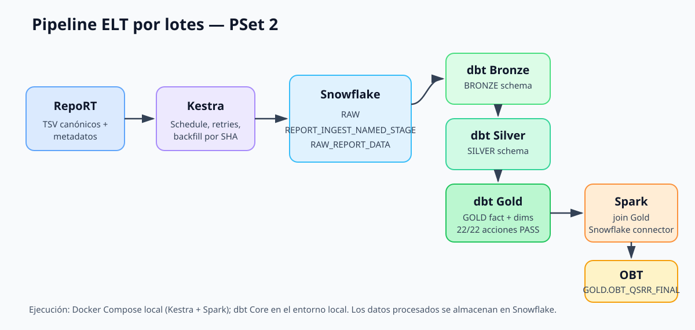
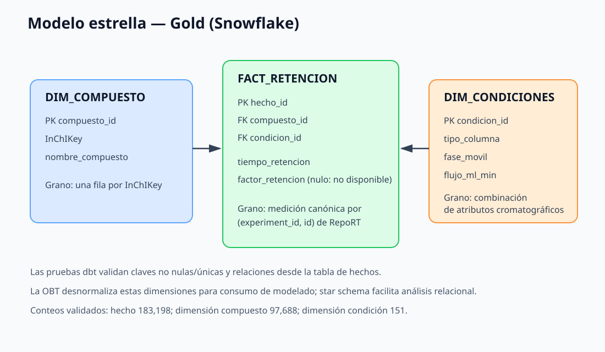

# PSET2
# Pipeline de datos end-to-end

**Proyecto:** datos RepoRT para preparar un conjunto de modelado de retención
cromatográfica.  
**Destino analítico:** `REPORT_QSRR_DB` en Snowflake.  
**Grano objetivo:** una medición canónica por clave de origen
`(experiment_id, id)`.

## 1. Arquitectura implementada

Para este proyecto elegí RepoRT como fuente porque publica mediciones
cromatográficas y sus condiciones experimentales. El flujo empieza en Kestra:
el extractor reúne los archivos de datos y sus metadatos, y carga una
instantánea en `RAW.RAW_REPORT_DATA`, en Snowflake. A partir de ahí, dbt prepara
las capas `BRONZE`, `SILVER` y `GOLD`. Por último, Spark combina la tabla de
hechos con sus dimensiones y deja el resultado en `GOLD.OBT_QSRR_FINAL`.

Docker Compose permite levantar Kestra y Spark en el entorno local. dbt Core se
ejecuta desde la terminal y se conecta a Snowflake mediante variables de
entorno. Así, el código y las instrucciones quedan en el repositorio, mientras
que los datos procesados y las tablas viven en Snowflake.

## 2. Ingesta con Kestra

La fuente es `michaelwitting/RepoRT`. El flujo toma como referencia inicial la
rama `master`, localiza los archivos `*_rtdata_canonical_success.tsv` y
descarga también los metadatos de cada experimento. Luego combina esa
información en un CSV con las mediciones, los identificadores químicos y las
características de la columna y la fase móvil.

Antes de cargar datos, Kestra crea el named stage y el formato CSV si todavía no
existen. Después sube el archivo comprimido, lo copia a una tabla transitoria
propia de la ejecución y reemplaza `RAW_REPORT_DATA` una vez que la carga
terminó. Como se trata de una instantánea completa, las ejecuciones posteriores
reemplazan la anterior en lugar de añadir otra copia. En la ejecución
documentada, Raw quedó con **183,199 filas**.

El flujo tiene un trigger semanal para los lunes a las 02:00 UTC. Los pasos de
Kestra pueden reintentarse hasta tres veces y las solicitudes al origen también
reintentan ante fallos transitorios. Para volver a procesar una versión
histórica, `source_ref` acepta una rama o un SHA. Como `master` puede cambiar,
guardar el SHA utilizado es lo que permite repetir exactamente una extracción.

## 3. Calidad y limpieza

Antes de transformar los datos, revisé completitud, precisión, consistencia y
validez con las reglas que permite comprobar la fuente. Estos fueron los
resultados y las decisiones que tomé:

| Dimensión / regla | Evidencia medida | Tratamiento |
|---|---:|---|
| Completitud de RT | 0 RT nulos | Bronze convierte RT a número; las filas sin valor numérico no avanzan como observaciones válidas. |
| Completitud química | 0 InChIKey nulos | Conservo InChIKey para identificar los compuestos en Gold. |
| Nombre del compuesto | 90,640 vacíos de 183,199 (49.5%) | No invento nombres que la fuente no entrega; el dato descriptivo puede quedar vacío. |
| Nombre de columna | 2,603 vacíos (1.4%) | Mantengo la medición y dejo nulos los atributos de columna que faltan. |
| Flujo | 12,177 ausentes o no positivos (6.6%) | No estimo caudales; las condiciones se identifican sin ocultar los valores ausentes. |
| Consistencia de la clave de origen | 0 duplicados por `(experiment_id, id)` | Uso la clave compuesta como `registro_id`; dbt valida que no sea nula ni duplicada en Bronze y Silver. |
| Consistencia referencial en Gold | 0 hechos sin compuesto o condición correspondiente; pasaron ambos tests `relationships` | Mantengo los hechos solo cuando sus claves encuentran una fila en cada dimensión. |
| Validez de RT | 1 RT no positivo | Silver excluye ese registro: un tiempo de retención no positivo no es válido para este análisis. |
| Precisión analítica | Sin medición externa de referencia | Uso los registros que RepoRT marca como canónicos exitosos, pero no afirmo que su precisión experimental haya sido verificada de forma independiente. |

En Bronze normalizo los nombres y los tipos necesarios para el análisis. En
Silver conservo una fila por `registro_id` y aplico una regla concreta:
`tiempo_retencion > 0`. No elimino filas solo porque compartan compuesto o
columna, ya que pueden ser mediciones distintas. Con esta regla, Silver queda
con **183,198 filas**. Los metadatos ausentes se conservan como ausentes, en vez
de descartarlos o completarlos con valores inventados.

## 4. Transformaciones y modelo dimensional

`BRONZE.STG_REPORT_DATA` toma la información de Raw mediante `source()`.
Después, `SILVER.INT_RETENCION_FILTRADA` usa `ref()` para depender de Bronze y
aplicar el filtro de retención positiva. Separar las capas de esta manera deja
claro de dónde viene cada dato y en qué paso se aplica cada regla.

En Gold construí un esquema estrella. El grano de
`GOLD.FACT_RETENCION_CROMATOGRAFICA` es una medición canónica por
`(experiment_id, id)`. La tabla conserva el tiempo de retención y el factor de
retención; RepoRT no publica este último, así que lo dejo nulo en vez de
calcularlo sin evidencia. `DIM_COMPUESTO` contiene una fila por InChIKey y
`DIM_CONDICIONES` una fila por combinación de tipo de columna, fase móvil y
flujo. Cuando falta un atributo descriptivo, la condición sigue teniendo una
clave identificable.

También añadí pruebas dbt para comprobar que las claves sean `not_null` y
`unique`, y que cada hecho tenga una fila correspondiente en sus dimensiones
(`relationships`). La ejecución pasó **22 de 22 acciones**. Gold produjo
**183,198 hechos**, **97,688 compuestos** y **151 condiciones**.

## 5. Spark y One Big Table

Una vez disponibles las tablas Gold, Spark 3.5 lee la tabla de hechos y las dos
dimensiones con el conector de Snowflake, integra sus atributos y escribe el
resultado en `GOLD.OBT_QSRR_FINAL`. El grano se mantiene en una fila por
`HECHO_ID`, es decir, una medición canónica.

Para evitar que los joins multipliquen observaciones, el job usa una fila
determinista por clave de dimensión y conserva los hechos aunque falten
atributos descriptivos. Después comparé la OBT con Gold en Snowflake: ambas
tienen **183,198 filas**, la OBT tiene **183,198 `HECHO_ID` distintos** y no
presenta IDs nulos. Los 2,603 casos sin metadatos de columna siguen presentes;
sus atributos descriptivos quedan nulos, pero las observaciones no se pierden
ni se duplican.

En este proyecto usaría el star schema para consultas analíticas y para
explorar por separado medidas y dimensiones. La OBT me resulta más práctica para
preparar variables de entrada y alimentar un futuro flujo de ciencia de datos,
siempre que se mantenga claro su grano y se compruebe que los joins no alteren
el número de observaciones.

## 6. Batch frente a streaming

Implementé el pipeline por lotes porque RepoRT es un repositorio público que se
actualiza, no una fuente que emite eventos continuamente. Para preparar datos
experimentales, una actualización semanal y una latencia de horas son
suficientes. El enfoque por lotes también permite reconstruir una instantánea
con un SHA de origen y controlar mejor la reproducibilidad y el costo.

Consideraría streaming si el caso de uso empezara a recibir mediciones de forma
continua y necesitara alertas o predicciones en segundos o minutos. En ese
escenario habría que incorporar una fuente de eventos, carga incremental,
checkpoints, procesamiento idempotente y manejo de eventos tardíos. No
implementé streaming porque esos requisitos no existen en el caso actual.

## 7. Limitaciones y reproducibilidad

El alcance comprobado en este PSet es la ingeniería del flujo con datos
públicos de RepoRT. No entrené ni evalué aquí un modelo QSRR con mediciones de
un laboratorio; por tanto, los conteos y pruebas reportados verifican el
pipeline, no la precisión predictiva ni su transferencia a otro laboratorio.

- RepoRT puede cambiar con el tiempo. Para repetir exactamente una carga hay
  que guardar el SHA utilizado en source_ref.
- No comparé la precisión experimental con mediciones externas de referencia.
- RepoRT no publica el factor de retención requerido por el modelo; por eso
  queda nulo y no se deriva artificialmente.
- Sin acceso a registros de laboratorio, la validación del proyecto se limita a
  RepoRT. El ahorro del 30% en corridas queda como hipótesis por comprobar, no
  como resultado medido ni como ahorro de negocio demostrado.
- Tampoco dispongo de una línea base de consumo por método: faltan el volumen
  de solvente por corrida y el número histórico de corridas preliminares. Esos
  datos permitirían calcular el consumo preliminar como volumen por corrida
  multiplicado por el número de corridas y luego compararlo con el proceso
  actual; no los infiero de RepoRT.
- La generalización a un laboratorio queda pendiente. Si se obtiene acceso,
  habría que acordar con el laboratorio el número de corridas locales de
  control y comparar el RMSE local con el de una evaluación del modelo en
  RepoRT. No asigno un número de corridas sin datos ni un protocolo
  experimental acordado.
- La validación predictiva posterior se limitará a RepoRT para columnas C18,
  sin extrapolar resultados a un laboratorio externo. Esta entrega conserva
  toda la fuente y todavía no filtra a C18; el subconjunto y la evaluación del
  modelo para esa fase quedan pendientes.
- Kestra usa almacenamiento local/H2. En un entorno nuevo hay que importar el
  flujo y su archivo Python al namespace antes de ejecutarlos.
- dbt necesita permisos para crear esquemas y tablas en Snowflake. La primera
  ejecución de Spark también requiere acceso a Maven Central para descargar el
  conector.
- Las tablas quedan en la cuenta Snowflake configurada al ejecutar el pipeline.

El repositorio incluye las instrucciones de ejecución, los diagramas y este
memo. El perfil local de dbt y el archivo `.env` se excluyen del control de
versiones.
