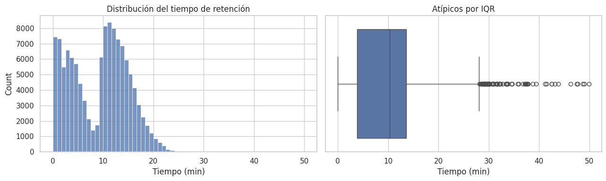
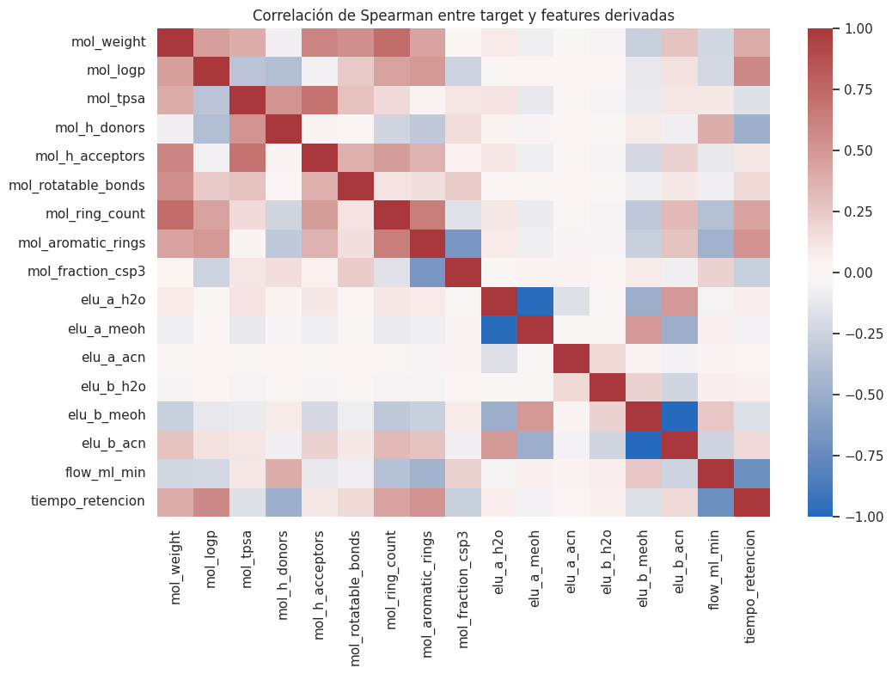
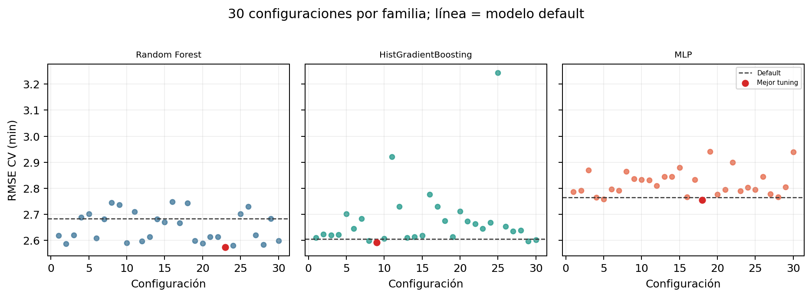
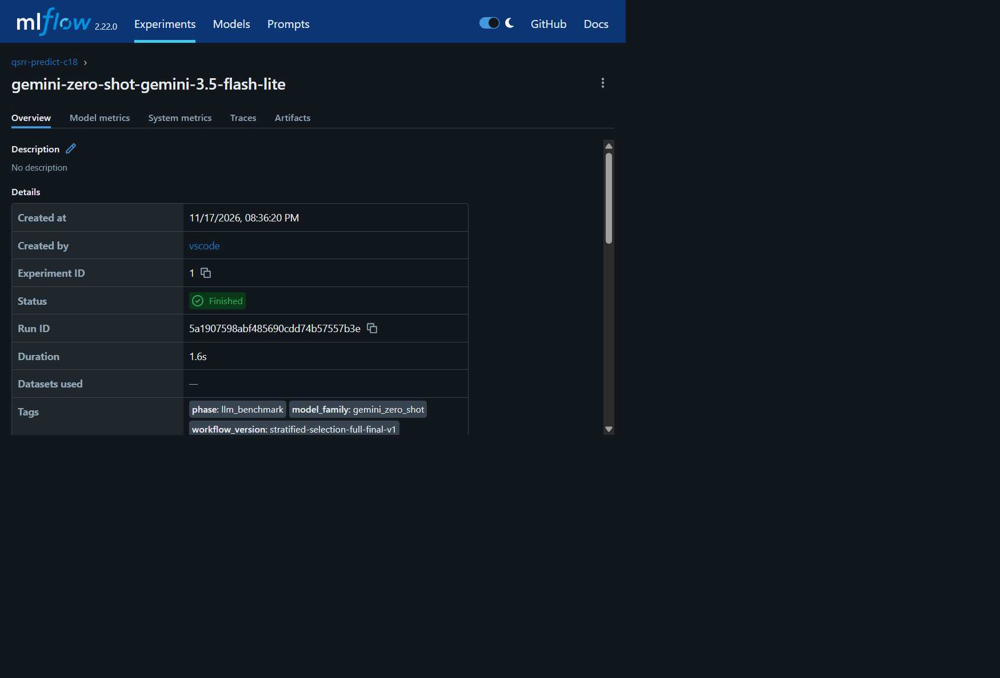

# Documento técnico — PSet 3: experimentación y selección de modelo

**Proyecto:** QSRR-Predict · **Autor:** Jonatan Buenaño · **Fecha:** 18 de noviembre de 2026
**Objetivo:** estimar el tiempo de retención (min) para observaciones C18 de RepoRT.

## 1. EDA: hallazgos que determinaron el diseño

La instantánea de la OBT del PSet 2 contiene **152.586 observaciones** de RepoRT C18, **96.482 compuestos** y SMILES válidos en todas las filas. El split agrupado deja **122.370 observaciones de desarrollo** (77.185 compuestos) y **30.216 de holdout**. En desarrollo hay 28 tipos de columna y 75 combinaciones de columna/fase móvil/flujo.

| Hallazgo en desarrollo | Evidencia | Consecuencia |
|---|---|---|
| Retención acotada, bimodal y sin cola larga | Mediana 10,342; IQR 9,713 min; asimetría 0,08; curtosis −0,75; modas en 2–6 y 10–16 min; 7,4% < 1 min. Solo 94 atípicos IQR (0,077%) y 149 con \|Z\| ≥ 3. | Sin cola larga se mantiene RMSE como métrica técnica (MAE complementaria). `log(1+target)` se probó por CV y empeoró el RMSE en 0,073 min: se descarta. Los atípicos se conservan. |
| Métodos heterogéneos y repetición de moléculas | 77.185 grupos InChIKey, 28 tipos de columna y 75 condiciones en desarrollo. | El split y los folds agrupan por molécula; las repeticiones de un compuesto no se reparten entre entrenamiento y validación. |
| Faltantes concentrados en datos descriptivos | Flujo ausente en 4,35%; nombre del compuesto ausente en 53,38%. | El nombre se excluye; flujo se imputa dentro del pipeline de cada fold. |
| Retención asociada tanto a molécula como a método | Spearman: flujo −0,717; LogP 0,575; anillos aromáticos 0,530; donadores H −0,479. Se usa Spearman porque varias features son asimétricas (TPSA 2,9; donadores 2,7) y la relación esperada es monotónica, no lineal. | Se combinan descriptores fisicoquímicos y composición de la fase móvil. Son asociaciones exploratorias, no causales. |

{width=49%}
{width=49%}

Los gráficos y estadísticas se generaron sobre desarrollo; el holdout permaneció reservado hasta la evaluación final. Los atípicos no se eliminaron automáticamente porque RepoRT no permite distinguir un extremo experimental válido de un error de captura sin inspección adicional.

\newpage

## 2. Features y prevención de fuga

Las variables usadas se pueden obtener antes de medir la retención. El nombre, el identificador de observación y la variable objetivo no entran al estimador.

| Familia derivada | Variables | Justificación para QSRR | Disponibilidad y control |
|---|---|---|---|
| Molecular: 9 descriptores RDKit | Peso molecular, LogP, TPSA, donadores/aceptores H, enlaces rotables, anillos totales/aromáticos y fracción sp3. | Representan tamaño, lipofilia, polaridad y estructura; LogP y anillos muestran asociación en el EDA. | Se calculan determinísticamente desde SMILES válido. |
| Composición: 6 proporciones | H2O, MeOH y ACN en las fases A y B. | Representan la fuerza/composición de elución indicada por el método. | Se parsean desde la receta de fase móvil; valores no parseables quedan faltantes. |
| Operación: 1 variable | Flujo (mL/min). | Tiene la asociación monotónica más alta observada con retención (rho −0,717). | Se obtiene del método y se imputa si falta. |

**Prueba de no fuga:** `model_inputs` separa `X` (SMILES, columna, fase móvil y flujo), `y` (TIEMPO_RETENCION) y grupos (InChIKey). `MoleculeConditionFeatures` calcula 16 columnas sin consultar `y`; no incluye la columna del target, nombres ni variables calculadas a partir del resultado. Imputación y escalado son pasos del `Pipeline` de scikit-learn, por lo que se ajustan solo con la porción de entrenamiento de cada fold. El campo de tipo de columna está presente en la entrada cruda, pero no se usa en las 16 columnas derivadas. El notebook 02 verifica con `assert` seis condiciones: sin target ni IDs, features calculadas fila a fila, independientes de `y`, compuestos disjuntos entre train y holdout, grupos disjuntos por fold e imputación aprendida solo con el fold de entrenamiento.

**Evidencia de aporte (ablación por CV, HGB):** sin descriptores moleculares el RMSE sube de 2,604 a 3,844 min; sin condiciones del método, a 3,778 min. Ambos bloques aportan más que la desviación entre folds (0,24). Las fracciones de fase móvil solo mejoran 0,106 min sobre moleculares + flujo (no concluyente).

## 3. Preparación y validación

| Etapa | Filas / grupos | Uso |
|---|---:|---|
| Snapshot C18 | 152.586 / 96.482 | Fuente con SHA-256 `0c366b46…1a628210`. |
| Desarrollo | 122.370 / 77.185 | EDA, CV y tuning. |
| Muestra para comparar/tunear | 19.406 / 12.000 compuestos | Muestreo por grupos estratificado por quintiles de la mediana de retención, semilla 42. |
| Holdout agrupado | 30.216 observaciones | Evaluación final; no se usa para seleccionar hiperparámetros. |

Se usó `GroupKFold` de 5 pliegues por InChIKey en las dos líneas base y las cinco familias candidatas. Se reportan RMSE y MAE en minutos: RMSE prioriza evitar errores grandes; MAE permite interpretar el error absoluto típico. En el holdout también se reporta R², definido como métrica en el PSet 1. **Métrica de negocio:** la regla de alerta es el intervalo del 95% de la diferencia entre dos predicciones; se evalúa contra un evento químico independiente del modelo (\|Δt real\| ≤ 0,5 min en la misma condición), con recall como prioridad (no alertar una coelución obliga a repetir la corrida), precisión y tasa de alertas. La brecha de generalización de la tabla es `RMSE_CV − RMSE_train`, ambas medias de los folds.

\newpage

## 4. Diseño experimental

Se exportaron **112 ejecuciones** de `qsrr-predict-c18` en el archivo `corridas.csv`: **108 FINISHED, 2 KILLED y 2 FAILED**. Las 109 ejecuciones previas al benchmark LLM corresponden a líneas base, candidatos, tuning y selección; se añadieron tres intentos del benchmark Gemini, uno de ellos completado. Los estados fallidos y detenidos se conservan para trazabilidad, no se presentan como resultados válidos. Los notebooks 03–05 reutilizan las corridas `FINISHED` con el mismo hash de muestra, por lo que *Restart + Run All* no duplica evidencia; `06_reproducir_champion.ipynb` carga `models:/qsrr-predict-modelo@champion` y reproduce exactamente RMSE y MAE del holdout.

Cada ejecución registra fase/familia, configuración, semilla, esquema de validación, origen y hash de datos, muestra, métricas train/CV, brecha y tiempos; tuning añade los hiperparámetros. Los modelos finales guardan artefacto con firma y dependencias, métricas de holdout y parámetros de recursos. La captura del run de comparación y sus métricas se adjunta en el anexo.

## 5. Resultados

| Modelo (configuración por defecto) | RMSE train | RMSE CV media ± DE | MAE train / CV | Brecha RMSE | LR | CV total (s) |
|---|---:|---:|---:|---:|---:|---:|
| Mediana global (base) | 5,826 | 5,828 ± 0,090 | 4,874 / 4,875 | 0,002 | — | 0,09 |
| Mediana por condición (proxy) | 3,692 | 3,765 ± 0,405 | 2,523 / 2,584 | 0,073 | — | 0,16 |
| Ridge | 3,155 | 3,176 ± 0,200 | 2,257 / 2,278 | 0,022 | — | 8,12 |
| KNN | 2,089 | 3,064 ± 0,212 | 1,248 / 1,935 | 0,975 | — | 14,13 |
| MLP | 2,451 | 2,764 ± 0,204 | 1,623 / 1,846 | 0,313 | 0,001 | 66,09 |
| Random Forest | 1,119 | 2,683 ± 0,248 | 0,609 / 1,723 | 1,563 | — | 41,69 |
| HistGradientBoosting | 2,132 | 2,604 ± 0,240 | 1,356 / 1,693 | 0,472 | 0,100 | 11,19 |

El tiempo es la duración observada de la evaluación CV de cinco pliegues en el Codespace, no una comparación de hardware. Los métodos basados en árbol muestran brecha de entrenamiento mayor; por eso la decisión se toma con CV agrupada y holdout, no con el ajuste al entrenamiento.

\newpage

## 6. Tuning: búsqueda y mejora frente al default

Para las tres mejores familias por RMSE CV se evaluaron **30 configuraciones por familia (90 trials)** con búsqueda aleatoria y semilla 42. Las escalas de regularización y tasas de aprendizaje se muestrearon en escala logarítmica.

| Familia | Espacio explorado | Mejor configuración y resultado | Mejora frente al default |
|---|---|---|---:|
| Random Forest | `n_estimators` {100, 200, 300}; `max_depth` {None, 8, 16, 24}; `min_samples_leaf` {1, 2, 4, 8}; `max_features` {0,5; 0,8; 1,0}. | 300 árboles, profundidad 24, hoja 1, `max_features=0,5`; RMSE CV **2,573 ± 0,214**. | **4,08%** |
| HistGradientBoosting | `learning_rate` loguniform(0,01–0,2); iteraciones {100, 200, 300}; hojas {15, 31, 63}; hoja mínima {10, 20, 50}; L2 loguniform(1e−5–10). | LR 0,1804; 200 iteraciones; 31 hojas; hoja 10; L2 4,9353; RMSE CV **2,592 ± 0,250**. | **0,47%** |
| MLP | capas {(64), (128), (64,32)}; alpha loguniform(1e−6–1e−1); `learning_rate_init` loguniform(1e−4–1e−1). | 128 unidades; alpha 3,62e−5; LR inicial 0,000421; RMSE CV **2,754 ± 0,197**. | **0,36%** |

La mejora es `(RMSE_CV_default − RMSE_CV_mejor) / RMSE_CV_default`; valores positivos son mejores. En las tres familias la mejora absoluta (0,109; 0,012 y 0,010 min) es **menor que la desviación entre folds** (0,20–0,25 min), por lo que ninguna se considera concluyente. El tuning de HGB elige una tasa alta (0,18) y su brecha train–CV sube de 0,47 a 0,64 min. Los errores estándar se calcularon sobre los cinco folds, no sobre las 30 configuraciones.

\newpage

## 7. Decisión: campeón, prueba y señal de negocio

| Modelo registrado | Alias / versión | Run ID final | RMSE holdout (30.216 filas) | MAE holdout | R² holdout |
|---|---|---|---:|---:|---:|
| HistGradientBoosting | `champion` / **5** | `04483473d3314b51b7ee40f03ca90c94` | **2,329 min** | **1,529 min** | **0,828** |
| Random Forest, `max_samples=4096` | `challenger` / **7** | `b49f230a7813494481c464fbce79cef5` | 2,506 min | 1,633 min | 0,801 |

HistGradientBoosting queda como campeón porque su media de CV (2,5919) es ligeramente menor que la del Random Forest final ajustado por recursos (2,5934). La diferencia es solo **0,0015 min**, mucho menor que la desviación entre folds; no se afirma superioridad estadística concluyente. En el holdout completo también logra menor RMSE y MAE. La versión de Random Forest que obtuvo 2,5733 en tuning no es el artefacto final: para serializar en el Codespace se limitó cada árbol a 4.096 filas y esa variante se volvió a validar. HGB además pesa 0,73 MB frente a 159 MB del bosque y predice más rápido (≈367 vs. ≈426 ms por 1.000 filas). Su importancia por permutación se concentra en flujo (+3,3 min de RMSE), LogP (+2,6) y TPSA/donadores de H, coherente con fase reversa. Ninguno alcanza la meta del PSet 1 (RMSE ≤ 0,5 min; R² ≥ 0,90).

**Métrica de negocio (proxy).** El error de la diferencia entre dos predicciones es **1,53×** el de una sola (RMSE OOF 4,17 vs. 2,73 min), cercano al √2 ≈ 1,41 esperado; por eso el intervalo del 95% se calibró con 52.719 pares OOF (radio ±9,08 min) en lugar de usar una fórmula. En 61.742 pares del holdout, el evento \|Δt real\| ≤ 0,5 min ocurre en el 18,7%:

| Regla de alerta (sobre los mismos pares) | Umbral | Alertas | Recall | Precisión |
|---|---:|---:|---:|---:|
| **Intervalo 95% calibrado (elegida)** | 9,08 min | 91,2% | **99,1%** | 20,3% |
| 2 × RMSE × √2 | 7,72 min | 87,6% | 98,4% | 21,0% |
| 1 × RMSE × √2 | 3,86 min | 61,9% | 91,9% | 27,7% |
| 0,5 min fijo (PSet 1 original) | 0,50 min | 13,2% | 34,9% | 49,3% |

La regla elegida casi no omite coeluciones (falsos negativos 0,9%), pero su precisión apenas supera la tasa base: **con RMSE 2,3 min la alerta no discrimina y todavía no ahorraría corridas**. Un umbral más amplio aumenta el recall a costa de más falsas alarmas. RepoRT no tiene resolución ni ancho de pico ni registros de corridas o solvente; el evento es un proxy y el ahorro del 30% sigue siendo hipótesis.

Como comparación adicional, se pidió a Gemini 3.5 Flash-Lite una predicción zero-shot para **50 compuestos distintos del holdout**. El prompt incluyó SMILES y condiciones, nunca el tiempo real ni identificadores.

| Modelo, misma muestra de 50 | RMSE (min) | MAE (min) |
|---|---:|---:|
| Gemini 3.5 Flash-Lite | 5,344 | 4,528 |
| HistGradientBoosting | 2,064 | 1,302 |
| Random Forest | 2,103 | 1,360 |

En esta muestra pequeña los modelos supervisados tuvieron menor error. Gemini puede haber visto RepoRT durante el preentrenamiento; no es una comparación independiente.

\newpage

## 8. Limitaciones, alcance y reproducibilidad

| Limitación observada | Evidencia / efecto | Tratamiento en la conclusión |
|---|---|---|
| Sin datos de laboratorio local | Todo el entrenamiento y evaluación proceden de RepoRT C18; no hay columnas/equipos externos ni tiempos reales locales. | No se afirma transferencia. Antes de uso se requiere calibración local y comparación de RMSE con el protocolo RepoRT. |
| Métrica de negocio no observada | No hay conteo histórico de corridas ni mL de solvente por método; tampoco etiquetas reales de coelución. La alerta del 95% marca el 91,2% de los pares con precisión 20,3% (tasa base 18,7%). | El 30% es hipótesis a validar con piloto; las métricas pairwise no equivalen a ahorro ni coelución confirmada. |
| Recursos del Codespace | El artefacto Random Forest sin límite fue detenido; el final restringe cada árbol a `max_samples=4096`. | Se informa el ajuste y se compara con su CV revalidada (2,593 ± 0,216), no con el resultado del intento KILLED. |
| Muestra LLM acotada y posible contaminación | Gemini se comparó con 50 compuestos, y el proveedor no revela si RepoRT estuvo en sus datos de preentrenamiento. | Resultado exploratorio; no se generaliza a todo RepoRT ni se trata como benchmark independiente. |
| Reproducibilidad externa requiere acceso | Parquet y split están excluidos de Git; regenerarlos necesita credenciales propias y acceso a Snowflake. | No se versionan secretos ni datos privados. MLflow guarda artefactos en volumen Docker local. |

El monitoreo de features se demuestra offline comparando 20.000 filas de entrenamiento y 20.000 de holdout: PSI máximo 0,0080 en las 16 features y diferencia máxima de faltantes 0,0036. No es una deriva temporal ni un monitor productivo. En operación, PSI y faltantes se calculan en cada lote de moléculas nuevas (al menos semanal, como la ingesta de Kestra; alerta si PSI > 0,2). RMSE, MAE y cobertura requieren el tiempo real que mide el laboratorio al inyectar: se registran el día de la corrida y se recalculan al acumular 30 compuestos medidos o cada mes; si el RMSE supera 3,09 min (CV + 2σ) o la cobertura cae bajo 90%, se revisa o reentrena. MLflow conserva el alias, versiones y corridas; `corridas.csv` incluye **112** registros (108 FINISHED, 2 KILLED, 2 FAILED), incluidos los intentos fallidos para trazabilidad.

\newpage

## Anexo A. Evidencia de MLflow

Las capturas corresponden al run final `5a1907598abf485690cdd74b57557b3e`, estado FINISHED, en el experimento `qsrr-predict-c18`. El panel de métricas registra Gemini, champion y challenger sobre la misma muestra; la marca `target_labels_sent_to_provider=False` confirma que las retenciones reales no se enviaron a la API.

{width=49%}
{width=49%}
