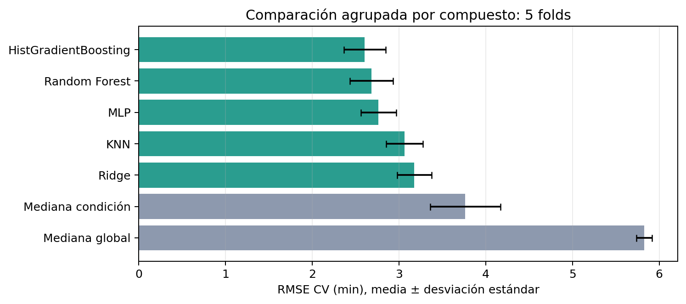
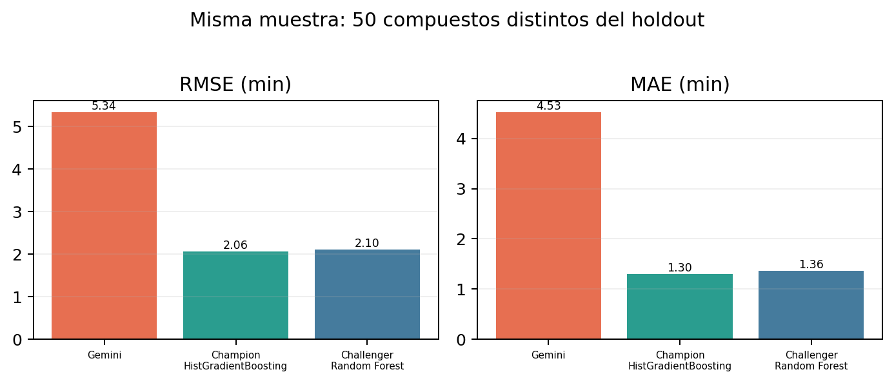
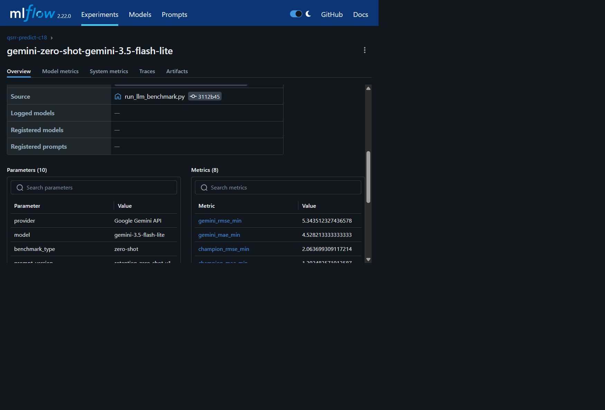
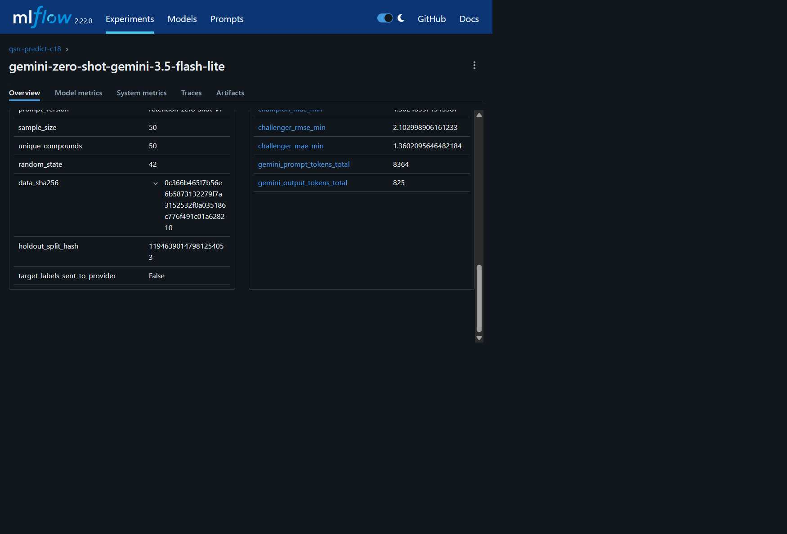

# Documento técnico — PSet 3: experimentación y selección de modelo

**Proyecto:** QSRR-Predict · **Autor:** Jonatan Buenaño · **Fecha:** 18 de noviembre de 2026
**Objetivo:** estimar el tiempo de retención (min) para observaciones C18 de RepoRT.

## 1. EDA: hallazgos que determinaron el diseño

### Punto de partida

Trabajé sobre la instantánea de la OBT que construí en el PSet 2. Contiene **152.586 observaciones** de RepoRT C18 que corresponden a **96.482 compuestos**, y todas las filas tienen un SMILES válido. Al separar los datos por compuesto quedaron **122.370 observaciones de desarrollo** (77.185 compuestos) y **30.216 de holdout**. Solo en desarrollo aparecen 28 tipos de columna y 75 combinaciones distintas de columna, fase móvil y flujo, lo que ya anticipaba bastante heterogeneidad entre métodos.

### Lo que encontré y cómo influyó en las decisiones

| Hallazgo en desarrollo | Evidencia | Consecuencia |
|---|---|---|
| Retención acotada, bimodal y sin cola larga | Mediana 10,342; IQR 9,713 min; asimetría 0,08; curtosis −0,75; modas en 2–6 y 10–16 min; 7,4% < 1 min. Solo 94 atípicos IQR (0,077%) y 149 con \|Z\| ≥ 3. | Como no hay cola larga, mantuve el RMSE como métrica técnica y usé el MAE como complemento. Probé `log(1+target)` en CV y el RMSE empeoró 0,073 min, así que lo descarté. Los atípicos se conservan. |
| Métodos heterogéneos y moléculas repetidas | 77.185 grupos InChIKey, 28 tipos de columna y 75 condiciones en desarrollo. | Tanto el split como los folds agrupan por molécula, para que un mismo compuesto no termine a la vez en entrenamiento y en validación. |
| Faltantes concentrados en datos descriptivos | Flujo ausente en 4,35%; nombre del compuesto ausente en 53,38%. | Excluí el nombre; el flujo se imputa dentro del pipeline de cada fold. |
| La retención depende de la molécula y del método | Spearman: flujo −0,717; LogP 0,575; anillos aromáticos 0,530; donadores H −0,479. Elegí Spearman porque varias features son asimétricas (TPSA 2,9; donadores 2,7) y la relación esperada es monotónica, no lineal. | Combiné descriptores fisicoquímicos con la composición de la fase móvil. Las tomo como asociaciones exploratorias, no como relaciones causales. |

{width=49%}
{width=49%}

Todos los gráficos y estadísticas salen del conjunto de desarrollo; el holdout no lo toqué hasta la evaluación final. Tampoco eliminé los atípicos de forma automática: con la información de RepoRT no hay manera de distinguir un valor extremo pero real de un error de captura sin revisarlo a mano.

\newpage

## 2. Features y prevención de fuga

### Variables utilizadas

Me limité a variables que se conocen antes de medir la retención. Ni el nombre, ni el identificador de la observación, ni el target entran al estimador.

| Familia derivada | Variables | Justificación para QSRR | Disponibilidad y control |
|---|---|---|---|
| Molecular: 9 descriptores RDKit | Peso molecular, LogP, TPSA, donadores/aceptores H, enlaces rotables, anillos totales/aromáticos y fracción sp3. | Describen tamaño, lipofilia, polaridad y estructura; en el EDA, LogP y los anillos mostraron asociación con la retención. | Se calculan de forma determinística a partir del SMILES válido. |
| Composición: 6 proporciones | H2O, MeOH y ACN en las fases A y B. | Reflejan la fuerza y composición de elución que define el método. | Se extraen de la receta de fase móvil; si no se pueden parsear, quedan como faltantes. |
| Operación: 1 variable | Flujo (mL/min). | Es la variable con la asociación monotónica más fuerte con la retención (rho −0,717). | Viene del método y se imputa cuando falta. |

### Prueba de no fuga

En `model_inputs` separo explícitamente `X` (SMILES, columna, fase móvil y flujo), `y` (TIEMPO_RETENCION) y los grupos (InChIKey). `MoleculeConditionFeatures` genera las 16 columnas sin consultar `y`, y no incluye el target, los nombres ni nada calculado a partir del resultado. La imputación y el escalado son pasos del `Pipeline` de scikit-learn, de modo que se ajustan únicamente con la parte de entrenamiento de cada fold. El tipo de columna llega en la entrada cruda, pero no forma parte de las 16 features derivadas. Para no depender solo de la revisión manual, el notebook 02 comprueba con `assert` seis condiciones: que no haya target ni IDs, que las features se calculen fila a fila, que sean independientes de `y`, que los compuestos de train y holdout sean disjuntos, que los grupos sean disjuntos por fold y que la imputación se aprenda solo con el fold de entrenamiento.

### ¿Aporta cada bloque de features?

Hice una ablación por CV con HGB. Al quitar los descriptores moleculares, el RMSE sube de 2,604 a 3,844 min; al quitar las condiciones del método, sube a 3,778 min. En ambos casos el cambio supera con holgura la desviación entre folds (0,24). En cambio, las fracciones de fase móvil apenas mejoran 0,106 min sobre el modelo con moleculares + flujo, lo que no me permite concluir que aporten de forma clara.

## 3. Preparación y validación

### Conjuntos de datos

| Etapa | Filas / grupos | Uso |
|---|---:|---|
| Snapshot C18 | 152.586 / 96.482 | Fuente con SHA-256 `0c366b46…1a628210`. |
| Desarrollo | 122.370 / 77.185 | EDA, CV y tuning. |
| Muestra para comparar/tunear | 19.406 / 12.000 compuestos | Muestreo por grupos estratificado por quintiles de la mediana de retención, semilla 42. |
| Holdout agrupado | 30.216 observaciones | Evaluación final; no se usa para elegir hiperparámetros. |

### Esquema de validación y métricas

Para las dos líneas base y las cinco familias candidatas usé `GroupKFold` de 5 pliegues agrupando por InChIKey. Reporto RMSE y MAE en minutos: el RMSE castiga más los errores grandes, que son los que más preocupan en el laboratorio, y el MAE da una idea más intuitiva del error típico. En el holdout añado el R², que fue la métrica definida en el PSet 1. La brecha de generalización que aparece en las tablas es `RMSE_CV − RMSE_train`, ambas como medias de los folds.

### Métrica de negocio

La regla de alerta se basa en el intervalo del 95% de la diferencia entre dos predicciones. La evalúo contra un evento químico que no depende del modelo (\|Δt real\| ≤ 0,5 min en la misma condición). Doy prioridad al recall, porque no alertar una coelución obliga a repetir la corrida, y reporto además la precisión y la tasa de alertas.

\newpage

## 4. Diseño experimental

### Registro de corridas

En total exporté **112 ejecuciones** del experimento `qsrr-predict-c18` al archivo `corridas.csv`: **108 FINISHED, 2 KILLED y 2 FAILED**. Las 109 anteriores al benchmark con LLM cubren líneas base, candidatos, tuning y selección; después se sumaron tres intentos del benchmark con Gemini, de los cuales uno se completó. Decidí conservar los estados fallidos y detenidos por trazabilidad, pero no los presento como resultados válidos. Los notebooks 03–05 reutilizan las corridas `FINISHED` que tienen el mismo hash de muestra, así que hacer *Restart + Run All* no duplica evidencia. Por su parte, `06_reproducir_champion.ipynb` carga `models:/qsrr-predict-modelo@champion` y reproduce exactamente el RMSE y el MAE del holdout.

### Qué se registra en cada ejecución

Cada ejecución guarda la fase y familia, la configuración, la semilla, el esquema de validación, el origen y hash de los datos, la muestra, las métricas de train y CV, la brecha y los tiempos; en el tuning se añaden los hiperparámetros. Los modelos finales incluyen el artefacto con firma y dependencias, las métricas de holdout y los parámetros de recursos. Las capturas del run de comparación y sus métricas están en el anexo.

## 5. Resultados

### Comparación con configuración por defecto

| Modelo (configuración por defecto) | RMSE train | RMSE CV media ± DE | MAE train / CV | Brecha RMSE | LR | CV total (s) |
|---|---:|---:|---:|---:|---:|---:|
| Mediana global (base) | 5,826 | 5,828 ± 0,090 | 4,874 / 4,875 | 0,002 | — | 0,09 |
| Mediana por condición (proxy) | 3,692 | 3,765 ± 0,405 | 2,523 / 2,584 | 0,073 | — | 0,16 |
| Ridge | 3,155 | 3,176 ± 0,200 | 2,257 / 2,278 | 0,022 | — | 8,12 |
| KNN | 2,089 | 3,064 ± 0,212 | 1,248 / 1,935 | 0,975 | — | 14,13 |
| MLP | 2,451 | 2,764 ± 0,204 | 1,623 / 1,846 | 0,313 | 0,001 | 66,09 |
| Random Forest | 1,119 | 2,683 ± 0,248 | 0,609 / 1,723 | 1,563 | — | 41,69 |
| HistGradientBoosting | 2,132 | 2,604 ± 0,240 | 1,356 / 1,693 | 0,472 | 0,100 | 11,19 |

El tiempo que reporto es la duración observada de la CV de cinco pliegues en el Codespace; no pretende ser una comparación de hardware. Los modelos basados en árboles muestran una brecha de entrenamiento mayor, y por eso basé la decisión en la CV agrupada y en el holdout, no en qué tan bien ajustan al entrenamiento.

\newpage

## 6. Tuning: búsqueda y mejora frente al default

### Espacio de búsqueda y resultados

Tomé las tres mejores familias según el RMSE de CV y evalué **30 configuraciones por familia (90 trials)** con búsqueda aleatoria y semilla 42. La regularización y las tasas de aprendizaje se muestrearon en escala logarítmica.

| Familia | Espacio explorado | Mejor configuración y resultado | Mejora frente al default |
|---|---|---|---:|
| Random Forest | `n_estimators` {100, 200, 300}; `max_depth` {None, 8, 16, 24}; `min_samples_leaf` {1, 2, 4, 8}; `max_features` {0,5; 0,8; 1,0}. | 300 árboles, profundidad 24, hoja 1, `max_features=0,5`; RMSE CV **2,573 ± 0,214**. | **4,08%** |
| HistGradientBoosting | `learning_rate` loguniform(0,01–0,2); iteraciones {100, 200, 300}; hojas {15, 31, 63}; hoja mínima {10, 20, 50}; L2 loguniform(1e−5–10). | LR 0,1804; 200 iteraciones; 31 hojas; hoja 10; L2 4,9353; RMSE CV **2,592 ± 0,250**. | **0,47%** |
| MLP | capas {(64), (128), (64,32)}; alpha loguniform(1e−6–1e−1); `learning_rate_init` loguniform(1e−4–1e−1). | 128 unidades; alpha 3,62e−5; LR inicial 0,000421; RMSE CV **2,754 ± 0,197**. | **0,36%** |

### Cómo interpreto la mejora

Calculo la mejora como `(RMSE_CV_default − RMSE_CV_mejor) / RMSE_CV_default`, de modo que un valor positivo indica que el tuning ayudó. Sin embargo, en las tres familias la mejora absoluta (0,109; 0,012 y 0,010 min) es **menor que la desviación entre folds** (0,20–0,25 min), así que no considero ninguna como concluyente. Llama la atención que en HGB el tuning elige una tasa de aprendizaje alta (0,18) y la brecha train–CV sube de 0,47 a 0,64 min. Los errores estándar se calcularon sobre los cinco folds, no sobre las 30 configuraciones.

\newpage

## 7. Decisión: campeón, prueba y señal de negocio

### Modelos registrados

| Modelo registrado | Alias / versión | Run ID final | RMSE holdout (30.216 filas) | MAE holdout | R² holdout |
|---|---|---|---:|---:|---:|
| HistGradientBoosting | `champion` / **5** | `04483473d3314b51b7ee40f03ca90c94` | **2,329 min** | **1,529 min** | **0,828** |
| Random Forest, `max_samples=4096` | `challenger` / **7** | `b49f230a7813494481c464fbce79cef5` | 2,506 min | 1,633 min | 0,801 |

### Por qué HistGradientBoosting es el campeón

Elegí HistGradientBoosting porque su RMSE medio en CV (2,5919) es apenas menor que el del Random Forest final ajustado por recursos (2,5934). Hay que ser honestos con la diferencia: son solo **0,0015 min**, muy por debajo de la desviación entre folds, así que no hablo de superioridad estadística. Lo que sí inclina la balanza es que en el holdout completo también obtiene menor RMSE y MAE. Conviene aclarar que el Random Forest que llegó a 2,5733 en el tuning no es el artefacto final: para poder serializarlo en el Codespace limité cada árbol a 4.096 filas y volví a validar esa variante. A esto se suma que HGB pesa 0,73 MB frente a 159 MB del bosque y predice más rápido (≈367 vs. ≈426 ms por cada 1.000 filas). Su importancia por permutación se concentra en el flujo (+3,3 min de RMSE), LogP (+2,6) y TPSA/donadores de H, lo cual tiene sentido químico en fase reversa. Aun así, ninguno de los dos modelos alcanza la meta que planteé en el PSet 1 (RMSE ≤ 0,5 min; R² ≥ 0,90).

### Métrica de negocio (proxy)

El error al predecir la diferencia entre dos compuestos es **1,53×** el de una predicción individual (RMSE OOF 4,17 vs. 2,73 min), cercano al √2 ≈ 1,41 que se esperaría en teoría. Por eso preferí calibrar el intervalo del 95% con 52.719 pares OOF (radio ±9,08 min) en lugar de usar una fórmula. En los 61.742 pares del holdout, el evento \|Δt real\| ≤ 0,5 min ocurre en el 18,7% de los casos:

| Regla de alerta (sobre los mismos pares) | Umbral | Alertas | Recall | Precisión |
|---|---:|---:|---:|---:|
| **Intervalo 95% calibrado (elegida)** | 9,08 min | 91,2% | **99,1%** | 20,3% |
| 2 × RMSE × √2 | 7,72 min | 87,6% | 98,4% | 21,0% |
| 1 × RMSE × √2 | 3,86 min | 61,9% | 91,9% | 27,7% |
| 0,5 min fijo (PSet 1 original) | 0,50 min | 13,2% | 34,9% | 49,3% |

La regla elegida casi no deja pasar coeluciones (falsos negativos 0,9%), pero su precisión apenas supera la tasa base. Dicho de otra forma: **con un RMSE de 2,3 min la alerta todavía no discrimina y no ahorraría corridas**. Ampliar el umbral sube el recall, pero a costa de más falsas alarmas. Además, RepoRT no incluye resolución ni ancho de pico, ni registros de corridas o consumo de solvente, así que el evento es solo un proxy y el ahorro del 30% sigue siendo una hipótesis.

### Comparación con un LLM

Como ejercicio adicional, le pedí a Gemini 3.5 Flash-Lite una predicción zero-shot para **50 compuestos distintos del holdout**. En el prompt incluí el SMILES y las condiciones del método, pero nunca el tiempo real ni identificadores.

| Modelo, misma muestra de 50 | RMSE (min) | MAE (min) |
|---|---:|---:|
| Gemini 3.5 Flash-Lite | 5,344 | 4,528 |
| HistGradientBoosting | 2,064 | 1,302 |
| Random Forest | 2,103 | 1,360 |

En esta muestra, que es pequeña, los modelos supervisados cometieron menos error. Hay que tomarlo con cautela: es posible que Gemini haya visto RepoRT durante su preentrenamiento, así que no se trata de una comparación independiente.

\newpage

## 8. Limitaciones, alcance y reproducibilidad

### Limitaciones

| Limitación observada | Evidencia / efecto | Tratamiento en la conclusión |
|---|---|---|
| Sin datos de laboratorio local | Todo el entrenamiento y la evaluación provienen de RepoRT C18; no hay columnas o equipos externos ni tiempos reales locales. | No afirmo que el modelo se transfiera. Antes de usarlo haría falta calibrarlo localmente y comparar su RMSE con el protocolo de RepoRT. |
| Métrica de negocio no observada | No hay conteo histórico de corridas ni mL de solvente por método, ni etiquetas reales de coelución. La alerta del 95% marca el 91,2% de los pares con precisión 20,3% (tasa base 18,7%). | El 30% es una hipótesis que habría que validar con un piloto; las métricas por pares no equivalen a ahorro ni a coelución confirmada. |
| Recursos del Codespace | El artefacto Random Forest sin límite se detuvo; el final restringe cada árbol a `max_samples=4096`. | Informo el ajuste y lo comparo con su CV revalidada (2,593 ± 0,216), no con el intento KILLED. |
| Muestra LLM acotada y posible contaminación | Gemini se comparó con 50 compuestos, y el proveedor no revela si RepoRT estuvo en sus datos de preentrenamiento. | Lo trato como un resultado exploratorio; no lo generalizo a todo RepoRT ni lo considero un benchmark independiente. |
| La reproducibilidad externa requiere acceso | El Parquet y el split están fuera de Git; regenerarlos exige credenciales propias y acceso a Snowflake. | No se versionan secretos ni datos privados. MLflow guarda los artefactos en un volumen Docker local. |

### Monitoreo y trazabilidad

El monitoreo de features lo demuestro offline comparando 20.000 filas de entrenamiento con 20.000 de holdout: el PSI máximo es 0,0080 en las 16 features y la diferencia máxima de faltantes es 0,0036. Esto no es deriva temporal ni un monitor en producción. En operación, el PSI y los faltantes se calcularían en cada lote de moléculas nuevas (al menos una vez por semana, al ritmo de la ingesta de Kestra), con alerta si el PSI supera 0,2. El RMSE, el MAE y la cobertura necesitan el tiempo real que mide el laboratorio al inyectar: se registrarían el mismo día de la corrida y se recalcularían al acumular 30 compuestos medidos o cada mes. Si el RMSE pasa de 3,09 min (CV + 2σ) o la cobertura baja del 90%, tocaría revisar o reentrenar el modelo. MLflow conserva el alias, las versiones y las corridas, y `corridas.csv` incluye los **112** registros (108 FINISHED, 2 KILLED, 2 FAILED), incluidos los intentos fallidos para mantener la trazabilidad.

\newpage

## Anexo A. Evidencia de MLflow

Las capturas corresponden al run final `5a1907598abf485690cdd74b57557b3e`, en estado FINISHED, dentro del experimento `qsrr-predict-c18`. En el panel de métricas aparecen Gemini, el champion y el challenger evaluados sobre la misma muestra; la marca `target_labels_sent_to_provider=False` confirma que las retenciones reales no se enviaron a la API.

{width=49%}
{width=49%}
